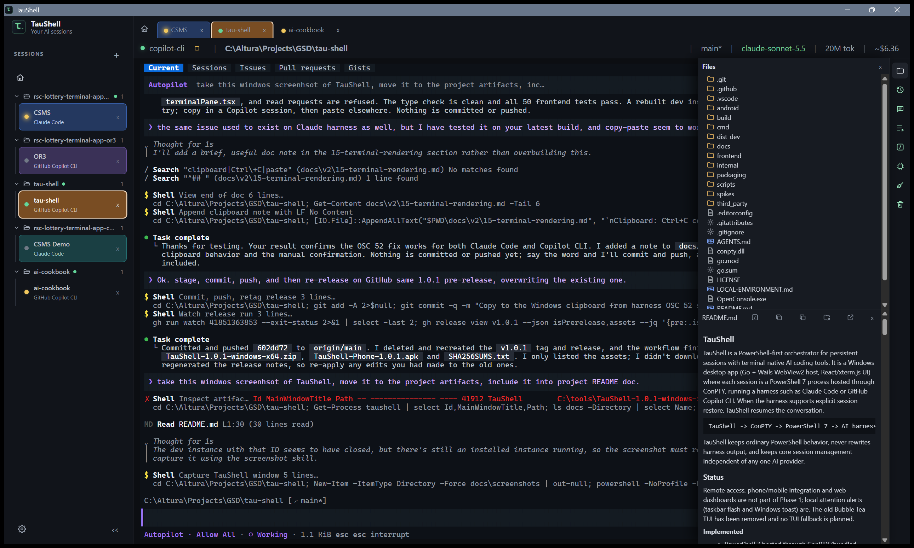
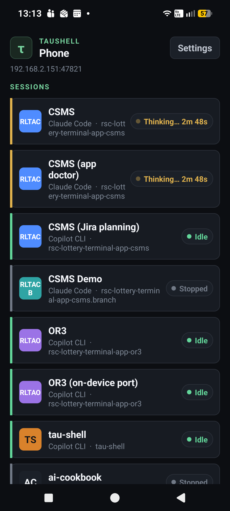

# TauShell

[](https://github.com/ma99us/tau-shell/releases)
[](LICENSE)


Install and update AI coding tools. Manage persistent sessions. Control them
from your Android phone on your local network.
TauShell is a Windows desktop app for Claude Code,
GitHub Copilot CLI, GSD, OpenAI Codex CLI and OpenCode.

Each session runs in ordinary PowerShell 7 through ConPTY, or, experimentally,
inside a WSL2 distro. TauShell preserves
the harness's terminal output and resumes its conversation where supported,
without replacing your shell or forcing you into one AI provider.



```text
TauShell -> ConPTY -> PowerShell 7 -> AI harness
TauShell -> ConPTY -> wsl.exe -> AI harness inside a WSL2 distro (experimental)
```

## Features

- **Tool installation and update assistance.** Detect installed tools,
  versions and missing dependencies. Install supported harnesses with
  confirmed winget/npm actions, or open vendor instructions. Use offered
  updates for supported tools. Install Node.js/npm and Git into TauShell's
  per-user folder without admin rights or registry PATH changes. No tool
  installs or updates without your approval.
- **Persistent sessions, restore and management.** Run different harnesses
  side by side. Switch between colored tabs and group sessions by project.
  Stop and resume conversations where supported. Use Resume All or opt-in
  auto resume for eligible sessions. Start fresh keeps your usage history.
- **Phone control.** Check session state, read visible terminal text, send
  prompts and receive alerts on your Android phone. Answer supported
  permission prompts. Connect on your local network, scan a QR code and
  approve the phone on the PC. The companion is experimental and off by
  default. It uses authenticated HTTPS with certificate pinning.
  [Phone setup](android/README.md).
- **Canned prompts and queued follow-ups.** The session's right-side toolbar
  has saved prompts and a prompt queue. Add tasks while an agent works.
  TauShell sends one prompt at a time when a supported harness is confirmed
  idle. It does not answer permission prompts or replace unsent text.
  Queued prompts are saved locally and survive restarts; after a restart the queue stays paused until you press Send in the queue popup.
- **Reusable skills from ai-cookbook.** Start with a bundled
  [ai-cookbook](https://github.com/mgerdov-igt/ai-cookbook) skill library,
  fetch newer snapshots, and enable the skills you want from Home. Supported
  harnesses receive them on launch or resume without overwriting your personal
  skill folders; availability and live verification vary by adapter.
- **Token, cost and price tracking.** See session totals beside the current
  model and monthly totals across harnesses, including deleted sessions.
  Copilot supplies recorded costs; Claude costs are list-price estimates with
  refreshable pricing. Unknown prices are marked unpriced rather than treated
  as free. A Home quota chip also shows Copilot allowance where available.
- **A practical session toolbar.** Browse project files, preview text,
  Markdown and images, insert paths into prompts, and revisit past
  conversations. Harness-aware controls expose slash commands, model
  selection, compaction, confirmed conversation clearing and interruption.
  Ctrl+Shift+P opens the command palette; Ctrl+1..9 and Ctrl+Tab switch tabs.
- **Project context and one-click Git sync.** See the working folder, branch,
  uncommitted/unpushed markers and last recorded model. While a session is
  visible, TauShell runs a quiet `git fetch` (never prompting, at most once a
  minute per repository, every 5 minutes) so incoming commits show as a down
  arrow. **Sync changes**
  stages and commits pending changes, pulls with rebase, then pushes. The
  file drawer has a **Git** tab listing only the changed files as a folder
  tree, with a status letter (M, A, D, R, U, !) on each row.
- **Git worktrees (opt-in).** Start or clone a session into its own worktree and
  branch so parallel sessions cannot collide. The top bar shows the worktree
  name in place of the branch, Sync publishes the new branch, and deleting the
  session can remove the folder and branch (blocked by unsaved work). Lightly
  verified; see [git worktrees](docs/v2/27-git-worktrees.md).
- **Open in your IDE.** The top bar shows a split button when the project
  folder has IDE markers (`.idea`, `.sln`, ...) and that IDE is installed;
  VS Code and Cursor are offered whenever installed. Icons come from the
  installed IDE. Detection was verified for VS Code, IntelliJ IDEA, Android
  Studio and Visual Studio; see [IDE integration](docs/v3/features/12-ide-integration.md).
- **Know which agent needs you.** State indicators, taskbar flash and Windows
  toasts flag input requests and completed turns. Session colors tint tabs,
  sidebar rows, the top bar and terminal edge to reduce wrong-session mistakes.
- **Portable, inspectable and extensible.** No desktop installer: session
  intent is editable YAML, runtime state is SQLite, and harness definitions
  are declarative manifests. Add custom manifests in
  `~/.tau_shell/harnesses/`. Home offers confirmed TauShell updates with
  rollback to the previous version.
- **Orderly shutdown.** Closing the app or a running tab asks first, interrupts
  gracefully, then force-stops what remains and reports it.
- **Themes and text size.** Dark, Light or System theme and adjustable UI and
  terminal text size (Home > Appearance). Harnesses with fixed backgrounds keep
  their own colors.

### Phone companion



Enable **Phone** on Home, select the PC's local-network address, and pair the
Android app. Only pair phones you trust: terminal text may contain sensitive
provider output. [Build, install and pair](android/README.md);
[security boundaries](docs/v2/11-security-model.md#phone-server-experimental-off-by-default).

## WSL sessions (experimental)

A session can run its harness inside a WSL2 distro instead of PowerShell 7, for
engineers who do not want the PowerShell dependency. Choose **Runtime: WSL** and
a distro when creating a session; Home cards show a runtime badge. Clone keeps
the original session's workspace and runtime. YAML records `runtime: wsl` and
`wsl.distro`; the working directory is a Linux path.

- Verified live on one machine (WSL 2.6.2, Ubuntu) with Claude Code and GitHub
  Copilot CLI. Codex CLI and OpenCode are not offered for WSL; GSD launches but
  its logs are not read. The CLI `start` command rejects WSL sessions.
- The Tools panel shows WSL and distro status, offers confirmed WSL/distro
  install and update (never restarts Windows or elevates silently), and shows
  "Update to X" when a newer WSL release exists.
- Git, the Files drawer and skills work against the distro; usage, model and
  title readers only read a running distro and never start it.
- Not verified: the install/update flows, multiple distros or users, corporate
  TLS inspection inside the distro, and the UI in a real window. Details:
  [`docs/wsl/`](docs/wsl/) and its [backlog](docs/wsl/06-backlog.md).

## Install

Download `TauShell-<version>-windows-x64.zip` from the
[Releases page](https://github.com/ma99us/tau-shell/releases), extract it
anywhere and run `taushell.exe`. There is no installer and no admin rights are
needed. Session data lives in `%USERPROFILE%\.tau_shell`. Later releases can be
installed from Home (**Update and restart**, with rollback).

Requires Windows 10 or later, the Microsoft Edge WebView2 Runtime and
either PowerShell 7 or a ready WSL2 distro (see [WSL sessions](#wsl-sessions-experimental));
first run offers confirmed installs and is skipped when WSL is ready. Missing harnesses do not
block Home; install them from the Tools panel or their vendor pages.

Releases are pre-releases and unsigned, so SmartScreen warns on first launch
(**More info**, then **Run anyway**, or unblock the ZIP first). Windows 11 Smart
App Control blocks unsigned apps. To verify a download:

```powershell
(Get-FileHash .\TauShell-<version>-windows-x64.zip -Algorithm SHA256).Hash   # compare with SHA256SUMS.txt
gh attestation verify .\TauShell-<version>-windows-x64.zip --repo ma99us/tau-shell
```

## Quick start

1. Run `taushell.exe` and choose **Create session**, or add
   `%USERPROFILE%\.tau_shell\sessions\<id>.yaml`:

   ```yaml
   id: backend-agent
   name: Backend Agent
   tool: claude-code
   working_dir: C:/Projects/App
   ```

2. Creating a session in the app starts it immediately. If you added YAML
   manually, start the session from Home. Right-click its tab (or its sidebar row) to rename, recolor, or
   open its YAML definition (**Edit session YAML**; also an icon on its Home tile).
   Changes apply the next time the session starts.
3. Stop and Restore later to resume the harness conversation where supported.

Schema and options: [YAML schema](docs/v2/18-yaml-schema.md).

### Command line

```powershell
taushell                         # open Home
taushell list
taushell start <session-id>
taushell restore <session-id>
taushell ctl list [--json] [--instance <pid>]      # ctl needs control.enabled: true
taushell ctl wait <session> [--for idle|input|working] [--timeout 10m]
taushell ctl send [--insert-only] [--stdin] <session> <text...>
taushell ctl start [--restore|--fresh] <session>
taushell ctl stop <session>                        # graceful, like the Stop button
taushell ctl read [--rows N] <session>             # visible terminal text
```

`ctl send` is refused unless the harness state is confirmed. `start` and `restore`
reject WSL sessions; start those from the app.

## Status

**Working desktop prerelease, not a production-stable release.** Core session
management, the terminal workspace, prompt/skill tools, usage tracking, setup
assistance and the experimental LAN phone companion are implemented.
Published builds are currently unsigned prereleases. General internet remote
access and web dashboards are not implemented.

The following are recorded, version-specific checks, not guarantees for every
installed version. See the [handoff](docs/v2/21-engineering-handoff.md) for
the test paths and remaining limits.

| Harness | Recorded verification |
|---|---|
| GitHub Copilot CLI | Launch, usage, skills and attention cues; real-turn restore on 1.0.104 |
| Claude Code | Version 2.1.316: real-turn restore and recall, activity/input cues, and graceful stop through the session manager and ConPTY; app-window tab/focus checks remain open |
| GSD | Version 1.18.0 (below the tested manifest range): launch, restore and recall, activity, model and usage; alternate-model reply and reliable native skill loading remain unverified |
| OpenCode | Version 1.19.5: launch, resume-ID discovery, stop and restore; model replies, usage, cues and interruption remain unverified |
| OpenAI Codex CLI | Version 0.166.0: live launch, restore and recall, usage, skill, activity and interrupt checks |

WSL sessions were checked live only with Claude Code and GitHub Copilot CLI on one
machine (WSL 2.6.2, Ubuntu); see [`docs/wsl/06-backlog.md`](docs/wsl/06-backlog.md).

Unicode, ANSI, cursor movement, typed input and live resize are verified through
WebView2, xterm.js and ConPTY on Windows 10. A background attention notification
was observed; taskbar flash alone and toast click-to-open were not separately
checked. Some newer UI behavior and a live winget install also remain
unverified. Open items are tracked in the
[engineering handoff](docs/v2/21-engineering-handoff.md).

## Build

Requires Windows, Go 1.26+, Node.js and Python 3.

```powershell
Push-Location frontend; npm ci; npm run build; Pop-Location
go test ./...
python build\windows\gen_icon.py
go build -tags production -ldflags "-H=windowsgui" -o taushell.exe ./cmd/taushell
.\scripts\fetch-conpty.ps1
```

- `-H=windowsgui` is required; without it a console window can cover the app.
- If `npm ci` fails with `EALLOWSCRIPTS`, set `$env:npm_config_allow_scripts=''`.
- `fetch-conpty.ps1` downloads the pinned, signature-checked ConPTY package.
  Without `conpty.dll` and `OpenConsole.exe` next to the exe, TauShell uses the
  Windows 10 inbox ConPTY, which has mouse and status-reply limitations.
- `.\scripts\build-release.ps1 -Version <x.y.z>` builds the release ZIP and
  `SHA256SUMS.txt`; CI runs it when a `v*` tag is pushed.

## Diagnostics

Each run writes a JSON log to `%TEMP%\TauShell\taushell.log` (path shown on
Home). Prompt text, terminal I/O, environment values and credentials are
excluded, and credential-like strings in errors are redacted.

## Documentation

[`docs/v2/`](docs/v2/) is the active documentation: start with the
[product vision](docs/v2/00-product-vision.md),
[system architecture](docs/v2/01-system-architecture.md) and
[contributor guide](docs/v2/17-contributor-guide.md). Also see
[adding a harness](docs/v2/23-adding-a-harness.md),
[UI design system](docs/v2/25-ui-design-system.md) and
[security model](docs/v2/11-security-model.md). The WSL runtime is documented in
[`docs/wsl/`](docs/wsl/). Agents and contributors using AI
tools should read [`AGENTS.md`](AGENTS.md).

## License

[MIT](LICENSE). Third-party notices: [`THIRD_PARTY_NOTICES.md`](THIRD_PARTY_NOTICES.md).
